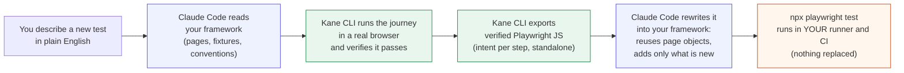
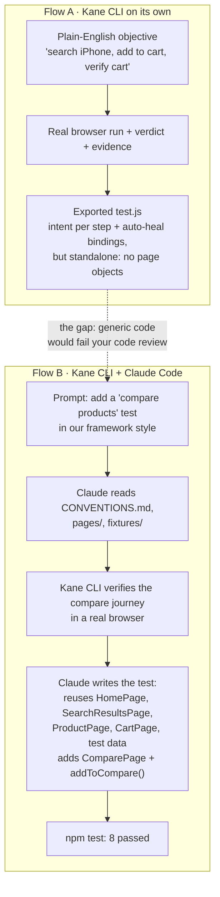
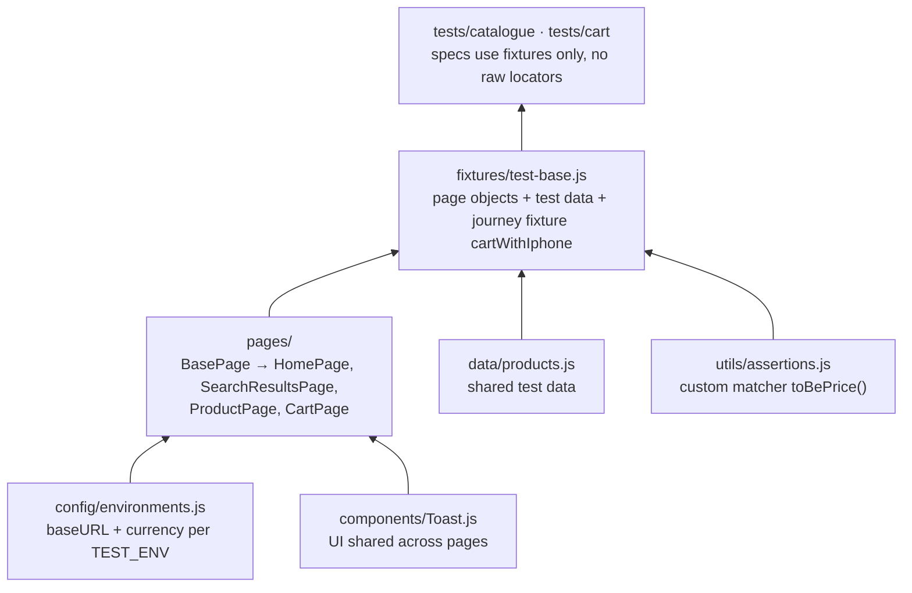

# autodesk-demo

A team-style Playwright (JavaScript) framework used to show one idea:

> **New tests should extend your existing framework, not replace it.**
> Your coding agent (Claude Code or Cursor) understands your code. **Kane CLI** proves the user journey works in a real browser. Together they produce a new test written in your framework's style, and you run it with your own Playwright setup.

---

## 1. The workflow at a glance



| Colour | Who does it |
|---|---|
| Purple | Your coding agent (Claude Code / Cursor): understands and edits your code |
| Green | Kane CLI: runs and verifies the journey in a real browser, exports code |
| Orange | Your existing infrastructure: runner, CI, dashboards, unchanged |

---

## 2. What each step proves in the demo



---

## 3. How the framework is layered

New tests are expected to plug into these layers. The demo shows the agent reusing them instead of writing raw Playwright.



| Folder | Holds | Rule |
|---|---|---|
| `config/` | Environments | Never hard-code URLs |
| `data/` | Test data | Reference by key, e.g. `products.iphone` |
| `components/` | Shared UI | Used by page objects, never by tests |
| `pages/` | Page objects | All locators live here; extend `BasePage` |
| `utils/` | Custom matchers | e.g. `toBePrice()` |
| `fixtures/` | Test fixture | Import `test` and `expect` from here |
| `tests/` | Specs by area | One journey per file, tagged `@smoke` / `@regression` |

Full rules: [CONVENTIONS.md](CONVENTIONS.md).

---

## 4. Before and after (the point of the demo)

**Kane CLI export (Flow A, real excerpt from `test.js`):** verified and runnable. Every step carries its plain-English intent, and the TestMu AI Playwright bindings add auto-heal (`autoHealVersion: "AH2"`). But it is standalone code, not written in your framework.

```js
import testmu from '@testmuai/playwright-bindings';

testmu.configure({ name: "Add iPhone to Cart and Verify", autoHealVersion: "AH2" /* ... */ });

testmu.test("Add iPhone to Cart and Verify", async (page) => {
  await testmu.step("Typing iPhone into product search input", { instructionId: "..." }, async () => {
    element_0 = page.locator('internal:role=textbox[name="Search For Products"i]');
    await element_0.fill("iPhone");
  });
  await testmu.step("Clicking Add to Cart button for iPhone purchase", { instructionId: "..." }, async () => {
    element_4 = page.locator('internal:role=button[name="Add to Cart"i]');
    await element_4.click();
  });
  // ...no page objects, no team fixture, no shared test data
});
```

**After Claude Code fits it into the framework (Flow B):**

```js
const { test, expect } = require('../../fixtures/test-base');

test('compare two products and add the chosen one to the cart', { tag: '@regression' },
  async ({ homePage, searchResults, productPage, comparePage, cartPage, products }) => {
    for (const product of [products.iphone, products.htc]) {
      await homePage.search(product.searchTerm);
      await searchResults.openProduct(product.name);
      await productPage.addToCompare();
    }
    await comparePage.open();
    await expect(comparePage.productNames()).toHaveText([products.iphone.name, products.htc.name]);
    await comparePage.addToCart(products.iphone.name);
    await cartPage.open();
    await expect(cartPage.itemNames()).toHaveText([products.iphone.name]);
});
```

Same verified journey. It now reuses the team's page objects, test data and fixture, and adds only one new page object.

---

## 5. Run it

```bash
npm install
npx playwright install chromium
npm test              # 7 tests on main
npm run test:smoke    # @smoke only
```

## Branches

| Branch | What it shows |
|---|---|
| `main` | The framework before the demo (7 tests) |
| `demo-solution` | After Flow B: the compare test in framework style (8 tests) |

The site under test is the public demo store https://ecommerce-playground.lambdatest.io.
